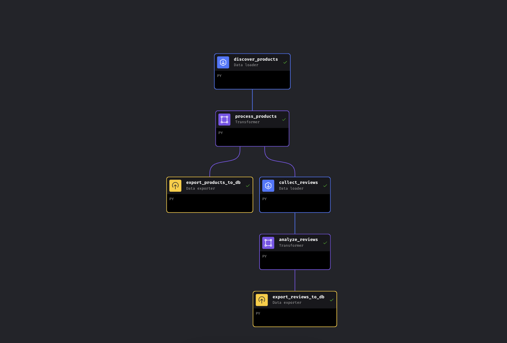
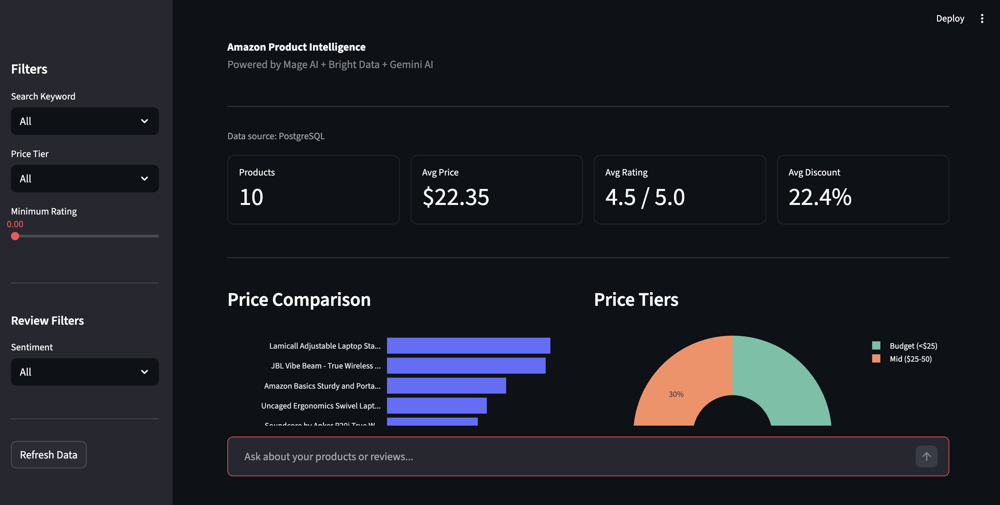

# Bright Data + Mage AI：亚马逊商品智能

一个 Python 流水线，通过 **Mage AI**、**Gemini** 和 **PostgreSQL** 串联 **两个 Bright Data 抓取工具**，采集并分析亚马逊商品数据。涵盖商品发现和 AI 驱动的评论分析。结果会显示在 **Streamlit 控制面板**中。使用 Docker 和单个 API 密钥即可运行。

**无需管理代理、无需破解 CAPTCHA，也无需应对反爬难题**。Bright Data 的网页爬虫工具 API 会处理所有这些问题。你只需发送关键词，即可获得整洁的结构化 JSON。此项目使用 Mage AI，但 Bright Data API 调用是标准 HTTP 请求，在 Airflow、Prefect、Dagster 或普通 Python 脚本中的工作方式完全相同。

**使用场景**：竞品价格监控、商品情绪跟踪、市场研究、批量评论分析。

## 快速开始

**前提条件**：Docker、一个 [Bright Data](https://www.bright.cn/) API 令牌（可免费试用，无需信用卡），以及可选的 [Gemini API 密钥](https://aistudio.google.com/apikey)（免费层即可；如果没有，流水线将回退到基于评分的情绪分析）。

```bash
git clone https://github.com/triposat/mage-brightdata-demo.git
cd mage-brightdata-demo
cp .env.example .env
# Add your BRIGHT_DATA_API_TOKEN (required) and GEMINI_API_KEY (optional) to .env
docker compose up -d
```

打开 `http://localhost:6789`，运行流水线（约 5–8 分钟），然后在 `http://localhost:8501` 查看结果。

## 工作原理

该流水线包含两个并行分支，共有 6 个区块：



| 区块 | 类型 | 功能 |
|-------|------|--------------|
| `discover_products` | 数据加载器 | 通过 Bright Data Products API 按关键词发现商品 |
| `process_products` | 转换器 | 使用价格区间、折扣和评分类别丰富数据 |
| `export_products_to_db` | 数据导出器 | 将商品存储到 PostgreSQL，并备份为 CSV |
| `collect_reviews` | 数据加载器 | 通过 Bright Data Reviews API 采集热门商品的评论 |
| `analyze_reviews` | 转换器 | 使用 Gemini AI 进行情绪分析，并提取问题和主题 |
| `export_reviews_to_db` | 数据导出器 | 将分析后的评论存储到 PostgreSQL，并备份为 CSV |

处理完商品后，流水线会进行**分支**：一个分支立即将商品导出到 PostgreSQL，另一个分支则采集评论、运行 AI 分析并导出结果。即使评论采集失败，商品数据也已安全保存。

## 示例输出

```
10 products for "laptop stand" + "wireless earbuds"
├── Soundcore Anker P20i Earbuds     | $19.99 | 4.4★ | 95,089 reviews
├── JBL Vibe Beam Earbuds            | $34.95 | 4.3★ | 34,826 reviews
├── BESIGN LS03 Laptop Stand         | $14.24 | 4.8★ | 22,845 reviews
├── Lamicall Adjustable Laptop Stand | $35.99 | 4.7★ |  9,966 reviews
└── ... (6 more)

Sentiment (Gemini AI): 90% Positive, 10% Negative
Top Themes: sound quality (15), value for money (6), battery life (6), comfort (4)
```

控制面板如下所示：



## 流水线变量

在 Mage UI 触发器中或直接在 `metadata.yaml` 中配置：

```yaml
variables:
  keywords:
    - laptop stand
    - wireless earbuds
  limit_per_keyword: 5
  top_n_products: 2
  reviews_per_product: 10
  sort_by: reviews_count
```

## 项目结构

```
mage-brightdata-demo/
├── docker-compose.yml          # Mage AI + PostgreSQL + Dashboard
├── dashboard.py                # Streamlit dashboard
├── .env.example                # Environment variable template
├── requirements.txt            # Python dependencies
└── mage_project/
    ├── data_loaders/
    │   ├── amazon_product_discovery.py    # Bright Data Products API
    │   └── amazon_reviews_collector.py    # Bright Data Reviews API
    ├── transformers/
    │   ├── process_amazon_products.py     # Product enrichment
    │   └── analyze_reviews.py             # Gemini AI (3-model rotation)
    ├── data_exporters/
    │   ├── export_products_to_db.py       # Products → PostgreSQL + CSV
    │   └── export_reviews_to_db.py        # Reviews → PostgreSQL + CSV
    └── pipelines/
        └── amazon_product_intelligence/   # Pipeline config
```

## 使用的 Bright Data 爬虫工具

| 抓取工具 | 数据集 ID | 用途 |
|-----|------------|---------|
| [亚马逊商品](https://www.bright.cn/products/web-scraper/amazon) | `gd_l7q7dkf244hwjntr0` | 按关键词发现商品 |
| [亚马逊评论](https://www.bright.cn/products/web-scraper/amazon) | `gd_le8e811kzy4ggddlq` | 按商品 URL 采集评论 |

此演示使用亚马逊，但 Bright Data 为包括 Walmart、eBay、Google Shopping 等在内的 **100 多个网站提供现成的爬虫工具**。API 调用模式相同，只需使用不同的数据集 ID。要切换平台，请替换数据加载器区块中的 `DATASET_ID`，并调整输入参数以匹配新抓取工具的数据结构。详情请参阅[博客教程](https://www.bright.cn/blog/ai/mage-ai-with-bright-data)。

## 资源

- [博客教程](https://www.bright.cn/blog/ai/mage-ai-with-bright-data)：分步指南
- [Bright Data 网页爬虫工具 API 文档](https://www.bright.cn/products/web-scraper)：API 参考和数据集目录
- [Bright Data 免费试用](https://www.bright.cn/)：获取你的 API 令牌
- [Mage AI 文档](https://docs.mage.ai)：流水线编排框架

## 更多 Bright Data 产品

- [Bright Data MCP](https://github.com/bright-cn/brightdata-mcp)
- [亚马逊爬虫工具](https://github.com/bright-cn/Amazon-Scraper)
- [LinkedIn 抓取工具](https://github.com/bright-cn/LinkedIn-Scraper)
- [Twitter 爬虫](https://github.com/bright-cn/twitter-scraper)
- [Crunchbase 抓取工具](https://github.com/bright-cn/crunchbase-scraper)
- [搜索引擎 API](https://github.com/bright-cn/serp-api)
- [Google 搜索 API](https://github.com/bright-cn/google-search-api)
- [Google 评论 API](https://github.com/bright-cn/google-reviews-api)
- [Google 地图爬虫工具](https://github.com/bright-cn/Google-Maps-Scraper)
- [Google 新闻抓取工具](https://github.com/bright-cn/Google-News-Scraper)
- [Google Trends API](https://github.com/bright-cn/google-trends-api)
- [Google 酒店 API](https://github.com/bright-cn/google-hotels-api)
- [Google 航班 API](https://github.com/bright-cn/google-flights-api)
- [Yandex API](https://github.com/bright-cn/yandex-api)
- [DuckDuckGo API](https://github.com/bright-cn/duckduckgo-api)
- [Zillow 爬虫](https://github.com/bright-cn/zillow-scraper)
- [MLS 抓取工具](https://github.com/bright-cn/mls-scraper)
- [网络解锁器 API](https://github.com/bright-cn/web-unlocker-api)
- [TrendScan](https://github.com/bright-cn/trendscan)
